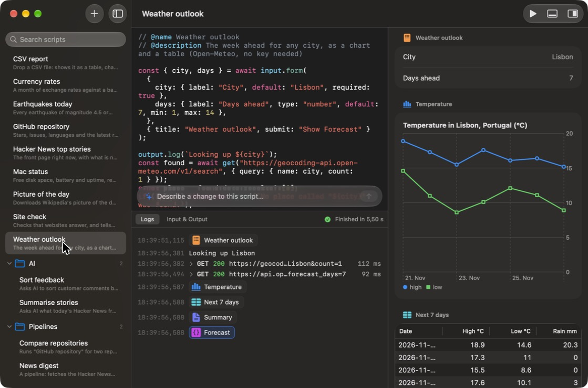
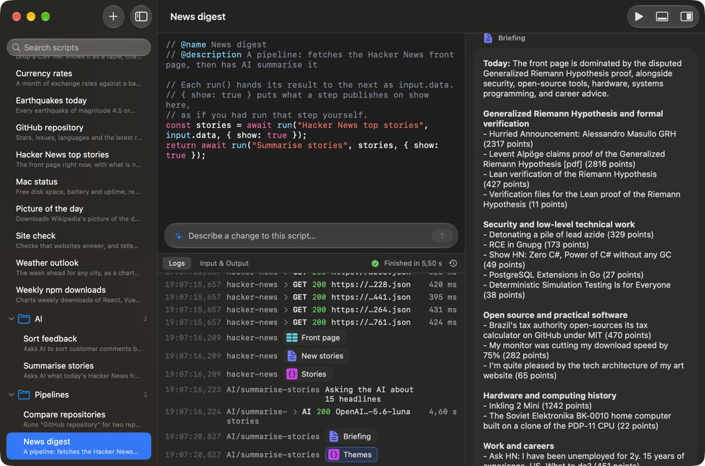

# Rhino

Rhino is a Mac app that runs small automation scripts: single JavaScript files with a built-in API for input, output, HTTP, files, secrets, memory and AI. You write a script by hand or describe it to the AI writer, then run it by hand, with a key, on a schedule, when a file arrives in a folder, or from the Shortcuts app.



## A script

A script is one `.js` file of plain top-level code. This one reports the issues opened in a repository since its last run:

```js
// @name New issues
// @description Lists the issues opened since the last run
// @schedule weekdays at 09:00

// Asked for once, kept in the Keychain, and hidden in logs and recorded calls.
const token = await secrets.get("GITHUB_TOKEN", "A GitHub personal access token");

// The default is also the answer when nobody is there, as on a scheduled run.
const repo = await input.ask("Which repository?", { default: "swiftlang/swift" });

// A status outside 2xx throws, which fails the run and shows the line.
const res = await get(`https://api.github.com/repos/${repo}/issues`, {
  headers: { Authorization: `Bearer ${token}` },
  query: { state: "open", per_page: 50 },
});

// Each script has its own memory, kept between runs.
const seen = await memory.get("seenIds", []);
const fresh = res.data.filter((issue) => !seen.includes(issue.id));
await memory.set("seenIds", [...seen, ...fresh.map((issue) => issue.id)]);

output.log(`${fresh.length} new issues in ${repo}`);
output.table(fresh.map((issue) => ({ number: issue.number, title: issue.title })))
  .name(`New issues in ${repo}`);

if (fresh.length > 0) notify("New issues", `${fresh.length} in ${repo}`);

// The last output.json() is the script's result: what run() and Shortcuts get back.
output.json(fresh.map((issue) => issue.number)).name("New issue numbers");
```

Run it once by hand so it can ask for the token. After that it runs by itself on weekdays at 09:00 while Rhino is open.

[docs/WRITING-SCRIPTS.md](docs/WRITING-SCRIPTS.md) is the guide. The full API is one file, [globals.d.ts](RhinoCore/Sources/RhinoCore/Resources/globals.d.ts), which the app also shows under Help > Script API Reference.

## Features

Scripts

- Plain `.js` files in one folder, organised in folders of your own. Edit them in the app or in any other editor.
- Search in the sidebar across names, descriptions and code; a line of code that matches opens the script at that line.
- An editor with syntax highlighting, Re-Indent (Control-I) to tidy indentation, and Open Quickly (Cmd-P) to find a script by name.
- Version history for every script, with a line-by-line comparison and restore.

Script API

- Input: `input.ask`, `input.form`, `input.file`, `input.confirm`, and files dropped on the script.
- Output: `output.log`, `output.json`, `output.table`, `output.chart`, `output.image`, `output.text`, `output.file`.
- HTTP: `get`, `post`, `put`, `patch`, `del`, `download`, `upload`.
- Files and CSV: `read`, `write`, `file.exists`, `file.list`, `csv.parse`, `csv.stringify`.
- `secrets.get`: passwords, keys and tokens, kept in the Keychain. A script only gets the ones you allowed it.
- `memory`: what a script remembers between runs.
- `ai.ask` and `ai.image`: questions and pictures from an AI model, with answers as plain text or as data in a shape you give.
- `notify`, `sleep`, and `input.from` to read what another script last produced.
- `run` to call one script from another. Chained, with each result handed to the next, that is a pipeline; a pipeline is a script too, so it can be scheduled or triggered like any other.
- `shell`: run a command as you would in Terminal and use what it prints.
- Your own shared functions, defined once in Settings and usable in every script.

Ways to run

- By hand: the Run button, the Run menu, or Cmd-R.
- `// @key cmd+shift+u`: a keyboard shortcut inside Rhino.
- `// @schedule weekdays at 09:00`: on a schedule, as a phrase or a cron expression.
- `// @watch ~/Downloads/*.pdf`: when a file arrives in a folder.
- The "Run Script" action in the Shortcuts app.

Scheduled and watching scripts only run while Rhino is open. Closing the window keeps it running, and a setting opens it at login.

AI writer

- Describe a script, or a change to one, and the writer produces the source.
- A written script is tried straight away and, if it fails, sent back for up to two repairs. Before its first run Rhino lists what the script reaches for (hosts, files, commands, secrets) and asks; it asks again only when a change adds something new.
- "Fix with AI" after a failed run, and "Undo AI Change".
- Providers: Anthropic, OpenAI, Google, xAI, OpenRouter, Ollama, or one you add yourself. The writer and `ai.ask` each have their own choice of provider.

Runs

- Each run shows its log, its HTTP and AI calls, the questions it asked, and what it published.
- The last 50 runs of each script are kept, with their logs and calls.
- A scheduled or folder-triggered run that fails posts a notification that opens the run.

## Example scripts

A new installation starts with these. Each runs as it is, against a public service that needs no key (the two AI ones need a provider set up in Settings).

| Script | What it shows |
|---|---|
| Weather outlook | A form, two HTTP calls (Open-Meteo), a chart, a table and a summary. |
| GitHub repository | Parallel requests, a pie chart, and taking input from another script. |
| Hacker News top stories | Many requests at once, and `memory` to tell what is new since the last run. |
| Earthquakes today | A public feed (USGS) as a table and chart, and `notify` for the rare big one. |
| Currency rates | A month of ECB rates (Frankfurter) as a line chart. |
| Picture of the day | `download()` and `output.image()` with Wikipedia's featured picture. |
| Site check | Uptime checks with `memory` and `notify`; meant to be given a schedule. |
| CSV report | A dropped file as a table, a chart and a saved JSON file. Needs no network. |
| Mac status | `shell()`: disk space, battery and uptime. |
| AI / Sort feedback | `ai.ask()` with `returns`, so the answer comes back as data. |
| AI / Summarise stories | `input.from()` to build on another script's last result, then `ai.ask()`. |
| Pipelines / News digest | `run()` twice in a row with `{ show: true }`: fetch the front page, then summarise it. |
| Pipelines / Compare repositories | `run()` with data, twice in parallel, and a CSV file. |



## Requirements

- macOS 27
- Xcode 27
- [XcodeGen](https://github.com/yonaskolb/XcodeGen), to generate the Xcode project
- For the AI features: an API key for one of the providers, or Ollama running on the Mac

## Build and run

The Xcode project is generated from `project.yml` and is not checked in.

```sh
brew install xcodegen
xcodegen generate
open Rhino.xcodeproj
```

Then run the `Rhino` scheme.

To build a release and install it in `/Applications` instead:

```sh
Tools/install.sh
```

The script signs the app with the identity named "Apple Development". Set `RHINO_SIGN_IDENTITY` to use another one. It quits any running copy of Rhino before it replaces the app.

Run the tests of the core package:

```sh
cd RhinoCore && swift test
```

The tests do not use the network.

## Where data lives

Everything is under `~/Library/Application Support/Rhino`:

| Path | What it holds |
| --- | --- |
| `Scripts/` | The scripts, one `.js` file each, in folders if you like. Example scripts are written here on first launch. |
| `Functions/` | Your shared functions, one `.js` file per group. |
| `Runs/` | One folder per run, for the files that run saved. |
| `Memory/` | What each script remembers, one JSON file per script. |
| `Versions/` | Earlier versions of each script, up to 100 per script. |
| `History.store` | The database of finished runs. |
| `SecretAccess.json` | Which scripts may use which saved secret. Names only, no values. |

API keys for AI providers and the secrets scripts ask for are in the Keychain, not in these folders. Which providers are set up, and the other settings, are in the app's preferences.

## Status

Rhino is early software, version 0.1.0. The script API and the layout of stored data may still change. There is no prebuilt download; you build it yourself. The app is not sandboxed, and scripts run with your privileges: read [SECURITY.md](SECURITY.md) before you run a script you did not write.

## More

- [docs/WRITING-SCRIPTS.md](docs/WRITING-SCRIPTS.md): how to write scripts by hand
- [docs/ARCHITECTURE.md](docs/ARCHITECTURE.md): how the code is organised and how a run works
- [CONTRIBUTING.md](CONTRIBUTING.md): setup, conventions, and how to add to the script API
- [SECURITY.md](SECURITY.md): the trust model, and how to report a problem
- [LICENSE](LICENSE): MIT
